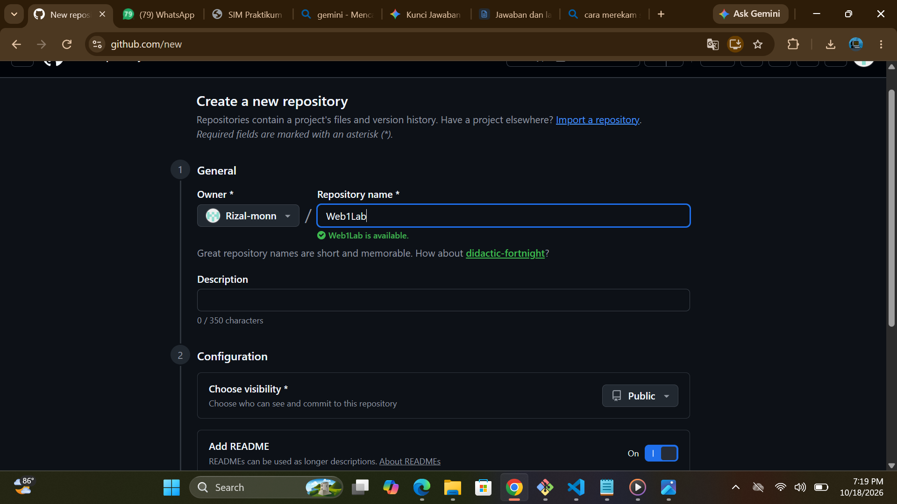
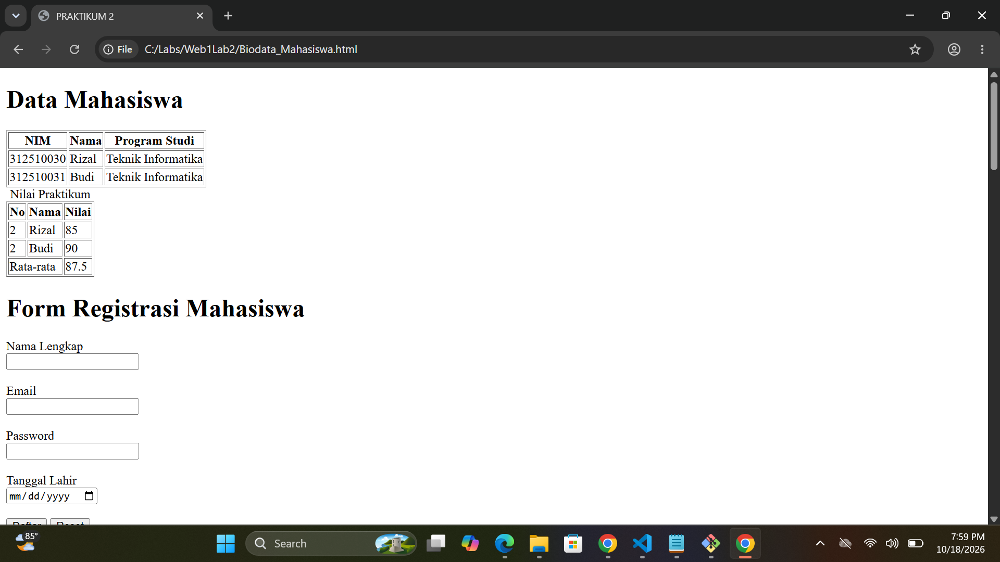
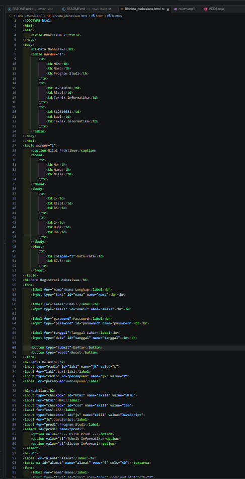
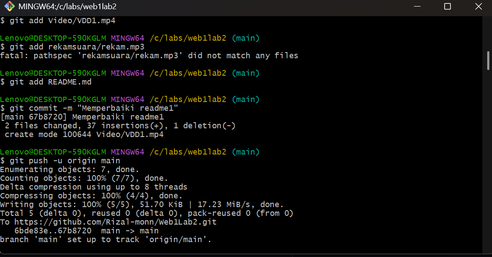
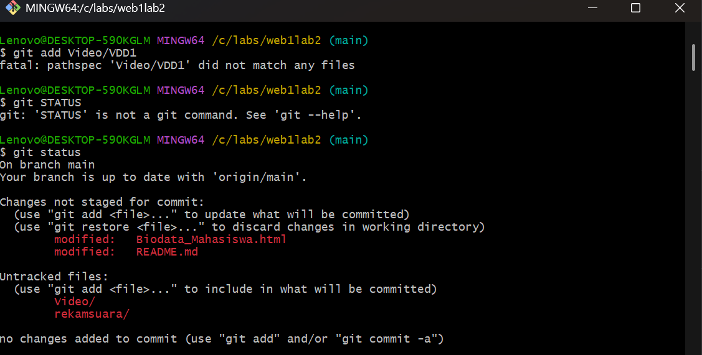
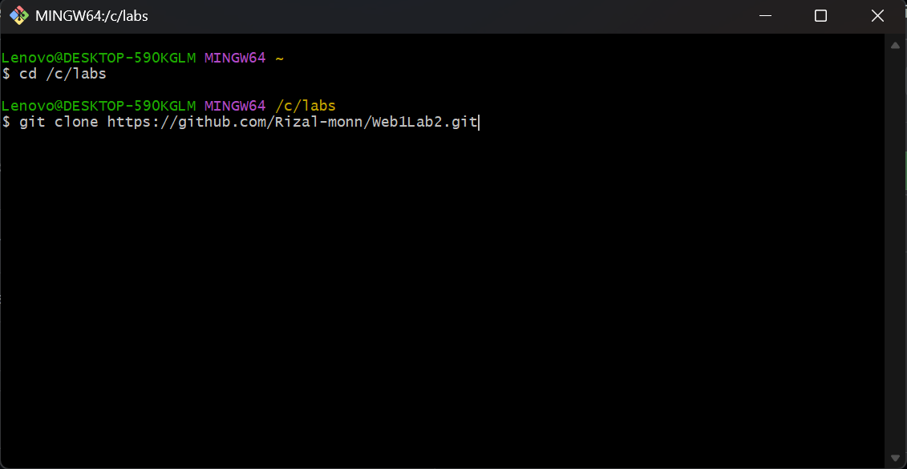

# Daftar gambar :

# Video :

### Lab2Web - Praktikum 2 HTML Lanjutan

Repository ini berisi hasil pengerjaan Praktikum 2: HTML Lanjutan dari mata kuliah Pemrograman Web. Praktikum ini bertujuan untuk memahami penggunaan tabel, pembuatan form dan jenis-jenis input, penerapan struktur semantic HTML, penyisipan elemen multimedia, serta validasi form dasar menggunakan atribut HTML.

## Penjelasan Langkah Praktikum

Berikut adalah penjelasan singkat dari setiap langkah yang dilakukan selama praktikum:

1. Membuat Tabel Data Mahasiswa

Membuat struktur tabel sederhana menggunakan tag <table>, <tr>, <th>, dan <td> untuk menyajikan data mahasiswa (seperti NIM, Nama, dan Program Studi) dalam bentuk baris dan kolom.
(Tempatkan screenshot hasil browser di sini)

2. Mengembangkan Tabel dengan thead, tbody, dan tfoot

Meningkatkan struktur tabel agar lebih terorganisir dengan membaginya menjadi bagian <thead>, <tbody>, dan <tfoot>. Selain itu, ditambahkan elemen <caption> sebagai judul tabel dan atribut colspan untuk menggabungkan sel.
(Tempatkan screenshot hasil browser di sini)

3. Membuat Form Registrasi Mahasiswa

Membuat formulir interaktif menggunakan tag <form> dan <label> yang terhubung dengan <input> untuk menerima data pengguna seperti teks, email, password, dan tanggal lahir, serta tombol submit dan reset.
(Tempatkan screenshot hasil browser di sini)

4. Radio Button dan Checkbox

Menerapkan jenis input pilihan pada form. <input type="radio"> digunakan untuk memilih satu dari beberapa opsi (misalnya Jenis Kelamin), sedangkan <input type="checkbox"> digunakan untuk memilih lebih dari satu opsi (misalnya Keahlian).
(Tempatkan screenshot hasil browser di sini)

5. Select dan Textarea

Menambahkan elemen <select> dan <option> untuk membuat daftar pilihan dropdown (pilihan Program Studi) serta tag <textarea> untuk kolom pengisian teks yang membutuhkan banyak baris (pengisian Alamat).
(Tempatkan screenshot hasil browser di sini)

6. Validasi Form Dasar

Menerapkan atribut validasi dasar pada elemen input seperti required (wajib diisi), minlength (panjang karakter minimal), serta min dan max (batas nilai angka) untuk memastikan data yang diinput pengguna valid sebelum dikirim.
(Tempatkan screenshot hasil browser di sini)

7. Membuat Halaman Semantic HTML

Membangun struktur dokumen halaman web yang bermakna (semantic) menggunakan elemen <header>, <nav>, <main>, <section>, <article>, <aside>, dan <footer> agar halaman terstruktur secara logis.
(Tempatkan screenshot hasil browser di sini)

8. Menambahkan Multimedia

Menyisipkan berkas media audio dan video pada halaman web menggunakan tag <audio> dan <video> yang dilengkapi dengan atribut controls serta tag <source>.
(Tempatkan screenshot hasil browser di sini)

9. Proyek Mini (Form Biodata Mahasiswa)

Menggabungkan seluruh materi yang telah dipelajari (Semantic HTML, Tabel data, Form registrasi, Validasi dasar, dan Multimedia) ke dalam satu proyek halaman "Biodata Mahasiswa" yang utuh.
(Tempatkan screenshot hasil akhir browser di sini)

## Jawaban Pertanyaan Modul

1. Apa fungsi <table>, <tr>, <th>, dan <td>?

<table>: Berfungsi sebagai pembungkus utama untuk membuat struktur tabel secara keseluruhan.

<tr> (Table Row): Berfungsi untuk membuat baris di dalam tabel.

<th> (Table Header): Berfungsi untuk membuat sel judul atau kepala kolom/baris pada tabel.

<td> (Table Data): Berfungsi untuk membuat sel penampung data standar di dalam baris tabel.

2. Apa perbedaan <th> dan <td>?

<th> digunakan untuk judul/header kolom, sehingga teks di dalamnya otomatis dicetak tebal (bold) dan berposisi rata tengah (center) secara default.

<td> digunakan untuk isi/data tabel, sehingga teks di dalamnya memiliki bobot normal dan berposisi rata kiri (left) secara default.

3. Apa fungsi colspan pada tabel?

colspan (column span) berfungsi untuk menggabungkan dua atau lebih kolom secara horizontal menjadi satu sel pada baris tabel yang sama.

4. Apa fungsi <form> dalam HTML?

<form> berfungsi sebagai wadah untuk menampung elemen-elemen input (seperti teks, radio button, checkbox, dropdown, tombol) yang digunakan untuk mengumpulkan data dari pengguna dan mengirimkannya ke server.

5. Apa perbedaan radio button dan checkbox?

Radio Button (type="radio"): Hanya memungkinkan pengguna memilih satu opsi dari sekelompok pilihan yang tersedia.

Checkbox (type="checkbox"): Memungkinkan pengguna memilih satu atau lebih (banyak) opsi sekaligus dari sekelompok pilihan.

6. Mengapa <label> sebaiknya terhubung dengan id input melalui atribut for?

Karena menghubungkan atribut for pada <label> dengan id pada <input> akan meningkatkan aksesibilitas dan user experience (UX). Pengguna dapat mengklik teks label untuk langsung memfokuskan kursor atau mencentang kotak input yang terhubung.

7. Apa perbedaan <textarea> dengan input type text?

input type="text": Digunakan untuk menerima masukan teks satu baris (singkat), seperti nama atau judul.

<textarea>: Digunakan untuk menerima masukan teks banyak baris (panjang), seperti alamat, pesan, atau deskripsi.

8. Apa fungsi semantic HTML seperti <header>, <nav>, <main>, <section>, <article>, <aside>, dan <footer>?

Semantic HTML memberi makna kontekstual pada struktur halaman web sehingga mudah dipahami oleh browser, mesin pencari (SEO), dan screen reader.

<header>: Menandai bagian kepala/header halaman.

<nav>: Menandai bagian navigasi atau menu utama.

<main>: Menandai area konten utama yang unik pada halaman.

<section>: Mengelompokkan konten berdasarkan tema/topik tertentu.

<article>: Menandai konten mandiri yang berdiri sendiri.

<aside>: Menandai konten pelengkap/sampingan.

<footer>: Menandai bagian kaki/footer halaman.

9. Apa fungsi required, min, max, dan minlength?

required: Memastikan kolom input wajib diisi sebelum form dikirim.

min: Menentukan nilai angka atau tanggal minimum yang boleh dimasukkan.

max: Menentukan nilai angka atau tanggal maksimum yang boleh dimasukkan.

minlength: Menentukan jumlah karakter teks minimal yang harus diisi pengguna.

10. Apa perbedaan elemen <audio> dan <video>?

<audio>: Digunakan khusus untuk menyisipkan dan memutar berkas suara/audio pada halaman web.

<video>: Digunakan untuk menyisipkan dan memutar berkas video bergerak (yang dapat menyertakan suara) pada halaman web.